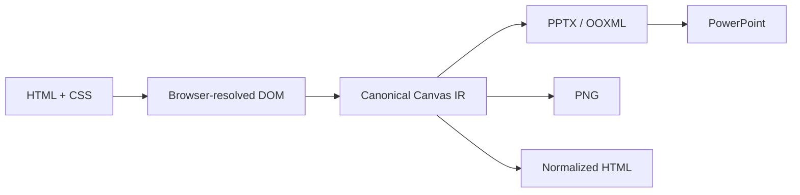
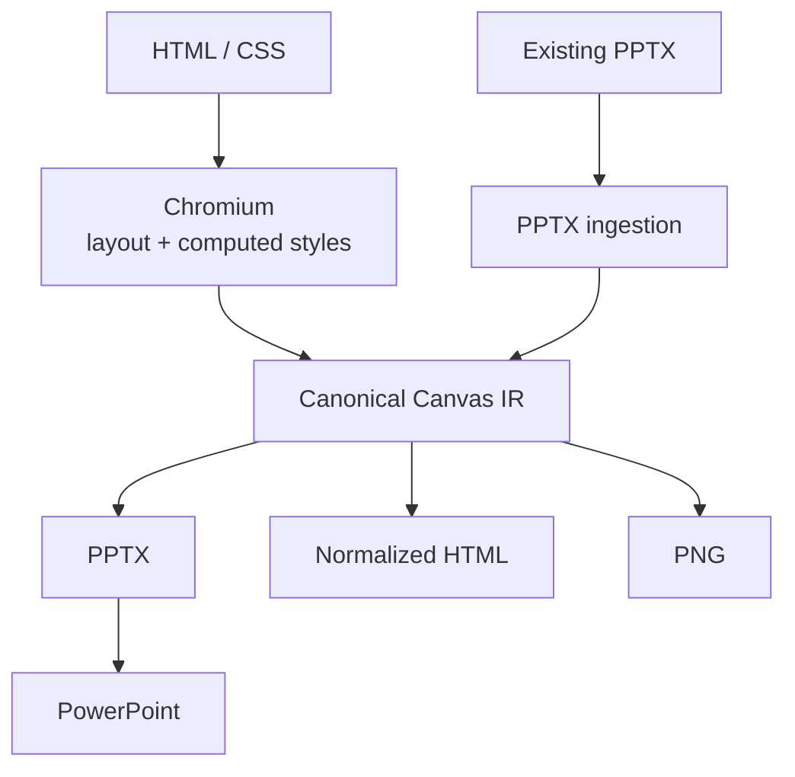
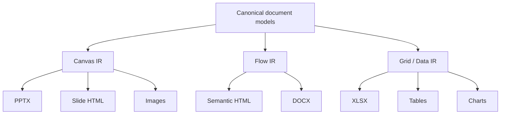
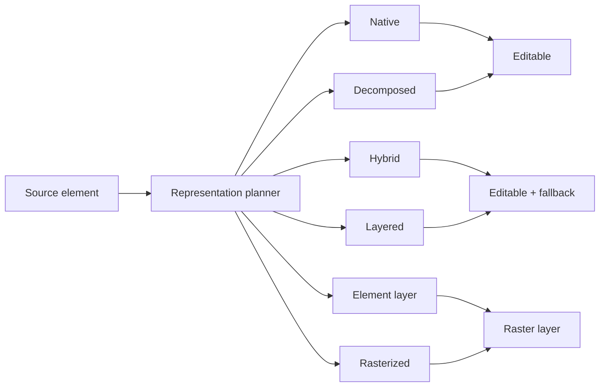
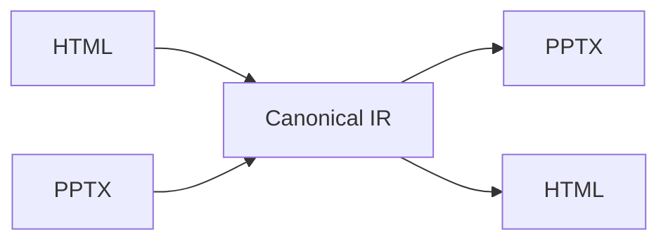
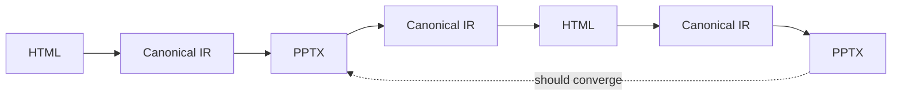
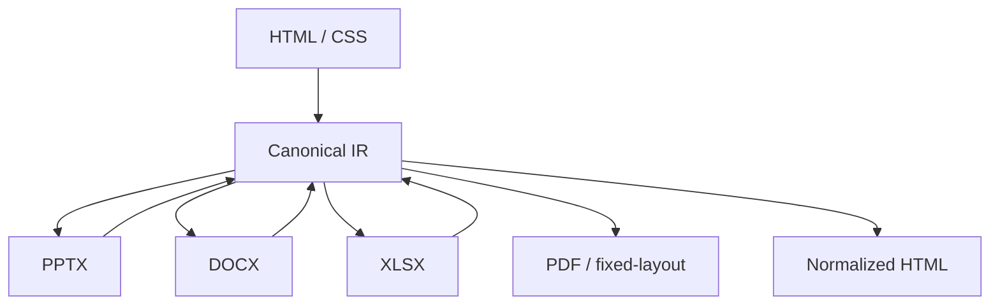
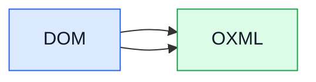

# domOXML

### DOM → OXML

**Turn HTML and CSS into editable Office documents.**

`domOXML` is a document compiler that uses ordinary HTML/CSS as its authoring surface and translates it into native, editable OOXML.

PowerPoint is the first target.

Write a slide like a web page. Let Chromium resolve the layout. `domOXML` captures that resolved document into a canonical intermediate representation, then emits a real `.pptx` — with native PowerPoint text, shapes, fills, images, geometry and effects wherever the target format can represent them.

When something genuinely cannot be represented natively, `domOXML` can fall back to carefully owned raster layers rather than silently dropping it.



The name is literal:

**domOXML = DOM → OXML**

---

## Why?

HTML and CSS are already an exceptionally powerful authoring language.

PowerPoint is an exceptionally useful delivery format.

The problem is the gap between them.

Most HTML-to-PowerPoint approaches either:

* screenshot the page and put the image on a slide, or
* translate a small, proprietary subset of HTML into shapes.

`domOXML` takes a different approach.

It treats HTML/CSS as the source language and OOXML as a target format.

That means the source can use the browser's layout and styling system, while the output can remain a real PowerPoint document.

**The goal is not a screenshot of a web page.**

The goal is a PowerPoint document whose content is still PowerPoint content.

---

## Quick start

`domOXML` is currently in **alpha** and is not yet published to PyPI.

### Requirements

* Python 3.12+
* Chromium via Playwright
* LibreOffice is optional and is used for local fidelity checking
* Microsoft Graph is optional and requires your own credentials

### Install from source

```bash
git clone https://github.com/Daftscientist/domOXML.git
cd domOXML

pip install -e .
playwright install chromium
```

For development:

```bash
pip install -e ".[dev]"
```

---

## Your first slide

```python
from pathlib import Path

from domoxml import Presentation, Slide
from domoxml.types import OutputFormat, SlideSize


deck = Presentation(size=SlideSize.WIDE_16_9)

deck.add(
    Slide(
        html="""
        <style>
          body {
            margin: 0;
            background: #111827;
            color: white;
            font-family: Inter, sans-serif;
            display: flex;
            align-items: center;
            justify-content: center;
          }

          h1 {
            font-size: 64px;
            letter-spacing: -0.04em;
          }

          span {
            color: #60a5fa;
          }
        </style>

        <h1>
          Coffee that tastes like <span>calm.</span>
        </h1>
        """
    )
)

result = deck.render({
    OutputFormat.PPTX,
    OutputFormat.PNG,
    OutputFormat.HTML,
})

result.save(Path("out/"))
```

The result can contain:

```text
out/
├── presentation.pptx
├── slide-01.png
└── html/
    └── slide-01.html
```

The `.pptx` is a real Office document rather than a screenshot wrapped in a PowerPoint package.

---

# What happens inside?

`domOXML` is deliberately not just an HTML parser followed by a pile of PPTX templates.

The pipeline is roughly:



The browser is responsible for the parts browsers are good at:

* CSS cascade
* computed styles
* layout
* fonts
* stacking contexts
* clipping
* transforms
* generated content
* SVG
* canvas
* replaced media

`domOXML` then works from that resolved state rather than trying to recreate a browser layout engine from scratch.

The internal representation is the important part.

HTML and PPTX are treated as **adapters around a canonical document model**, rather than either format becoming the internal source of truth.

---

# The canonical IR

The first target is PowerPoint, but the architecture is intentionally larger than PowerPoint.

The project uses document-family-specific IRs built from shared primitives.



The Canvas IR is the current centre of the PowerPoint pipeline.

It preserves an ordered sequence of content so heterogeneous objects retain their stacking order, while stable source identities and provenance allow the system to reason about objects across conversions.

This matters because conversion is not just about making pixels look right once.

It is about being able to understand what those pixels came from.

---

# Editability is a spectrum

Not every CSS feature has a native OOXML equivalent.

`domOXML` therefore does not treat the choice as simply:

```text
native OR screenshot
```

Instead, output can use several representation levels:



| Representation    | What it means                                                                |
| ----------------- | ---------------------------------------------------------------------------- |
| **Native**        | A target primitive directly represents the source feature                    |
| **Decomposed**    | Several native primitives reproduce it                                       |
| **Hybrid**        | Native/semantic content combined with rasterized effects or fallback layers  |
| **Layered**       | Independent raster layers reproduce parts of the source                      |
| **Element layer** | A source subtree is represented as one movable raster layer                  |
| **Rasterized**    | Pixels remain visible where independent editability cannot safely be claimed |

This is important because **visual fidelity and editability are different properties**.

A feature can be visually correct without being editable.

A feature can also be partially editable while using a raster layer for an effect that PowerPoint cannot reproduce.

`domOXML` records those distinctions rather than hiding them.

---

# No silent loss

One of the project's core rules is:

> **If something cannot be represented natively, don't silently make it disappear.**

Conversion produces coverage information and warnings describing what happened to source visuals.

A conversion can therefore distinguish between:

```text
native
decomposed
hybrid
layered
rasterized
approximated
failed
```

This makes conversion behaviour inspectable rather than magical.

For reverse conversion, unsupported constructs can also be retained as preserved source information instead of being discarded.

---

# HTML → PPTX

The current PowerPoint path supports native mappings for a growing range of visual primitives, including:

* text and rich text runs
* text decorations
* fonts
* solid fills
* gradients
* image fills
* borders and strokes
* shadows and effects
* preset geometry
* custom paths
* transforms
* images
* SVG/vector content
* tables
* hyperlinks
* groups
* connectors
* cropping
* backgrounds
* selected PowerPoint-specific effects

Unsupported visual features can use owned fallback layers where necessary.

The implementation deliberately prefers improving native mappings over treating rasterization as the default escape hatch.

---

# PPTX → HTML

`domOXML` can also ingest an existing `.pptx` and produce deterministic per-slide HTML/CSS.

```python
from pathlib import Path

from domoxml import pptx_to_html


html = pptx_to_html(Path("deck.pptx"))
html.save(Path("out/html"))
```

The reverse path is important.

The long-term model is not:

```text
HTML → PPTX
```

It is:



That gives the project a path towards genuine round-trip conversion rather than two unrelated one-way converters.

---

# Round trips

The architecture is designed around convergence.

For example:



Repeated conversion should not progressively destroy the document.

The same principle applies in the reverse direction:

```text
PPTX → HTML → PPTX
```

A capability is not considered truly complete merely because both conversion functions return successfully.

The project treats visual fidelity, structural fidelity, editability, preservation and repeated round trips as separate things that need evidence.

---

# Fonts

Fonts are part of the rendering problem.

`domOXML` captures and resolves the fonts used by the browser-rendered document and can carry the required font information into the generated presentation.

This is important for a system where HTML/CSS is allowed to be the actual design surface rather than a restricted template language.

---

# Fidelity testing

Fidelity is treated as an engineering problem rather than something judged by opening a few example PowerPoints by hand.

The repository contains:

* executable capability fixtures
* authored HTML fidelity cases
* real-world PPTX fixtures
* visual comparisons
* structural checks
* LibreOffice rendering
* optional Microsoft Graph / real PowerPoint rendering
* round-trip tests
* coverage and representation reports

The current baseline contains hundreds of tests and a substantial collection of PPTX capability fixtures.

The fidelity tooling is intentionally separate from the normal conversion path.

LibreOffice can be used locally for fidelity checks, while Microsoft Graph is available as an opt-in backend when real PowerPoint rendering is required.

---

# Current status

> **Alpha — actively developing.**

PowerPoint is the first target and the current implementation is already capable of:

* HTML/CSS → PPTX
* HTML/CSS → PNG
* HTML/CSS → normalized HTML
* PPTX → canonical Canvas IR
* PPTX → normalized HTML/CSS
* native OOXML generation
* native PPTX ingestion
* visual fallback layers
* source preservation
* coverage reporting
* conversion warnings
* embedded-font handling
* fidelity testing
* round-trip testing

The API is still expected to change.

The package is not yet on PyPI.

The broader architecture is deliberately ahead of the public API because the project is still establishing the underlying document model and format contracts.

---

# What is not finished?

There is a lot still to do.

Among the larger areas of remaining work are:

* broader HTML/CSS coverage
* more complete PowerPoint inheritance handling
* arbitrary masters and layouts
* placeholders
* animations and timing
* speaker notes
* more complete theme support
* broader source-group reconstruction
* additional preservation families
* more adversarial HTML and real-world PPTX corpus coverage
* broader renderer policy for unsupported effects
* full OOXML/XSD validation
* Strict-package validation
* broader AlternateContent and extension-schema validation
* additional document formats

The intended direction is not to declare a giant list of CSS properties “supported”.

It is to build a system where each capability has an explicit representation, preservation and fidelity contract.

---

# Architecture

The repository contains a more detailed architecture and format specification under `spec/`.

Useful starting points:

```text
spec/
├── architecture.md
├── implementation-roadmap.md
├── inventory-shared.md
├── inventory-pptx.md
├── inventory-docx.md
└── inventory-xlsx.md
```

The architecture document explains the canonical IR, document families, representation planner, preservation model and conversion invariants.

The inventories track format capabilities and their current implementation status.

---

# Repository layout

```text
domOXML/
│
├── domoxml/
│   ├── core/
│   │   ├── ir/          Canonical intermediate representation
│   │   ├── drawingml/   Shared DrawingML primitives
│   │   ├── opc/         OOXML package infrastructure
│   │   ├── render/      Browser rendering and capture
│   │   ├── fidelity/    Fidelity and comparison tooling
│   │   ├── html.py      HTML serialization
│   │   ├── fonts.py     Font resolution
│   │   ├── images.py    Image handling
│   │   └── ...
│   │
│   ├── slides/          PPTX ingestion and generation
│   ├── presentation.py  Public presentation API
│   └── types.py         Public and internal types
│
├── capabilities/
│   └── pptx/             Atomic PPTX capability fixtures
│
├── fidelity/
│   └── corpus/           Fidelity corpus
│
├── real-decks/
│   └── pptx/             Real-world PPTX fixtures
│
├── spec/                 Architecture and format inventories
│
├── tests/                Unit, integration and round-trip tests
│
├── scripts/              Development and fidelity tooling
│
└── docs/                 Documentation
```

---

# Development

Install the development dependencies:

```bash
pip install -e ".[dev]"
```

Enable the repository's git hooks:

```bash
git config core.hooksPath .githooks
```

Run the normal quality gate manually:

```bash
ruff check .
ruff format --check .
pyright
pytest
```

The pre-push hook runs the same core checks used by CI.

The full fidelity suite is intentionally not part of the automatic hook because it can require browser/rendering infrastructure and can be considerably slower.

---

# Fidelity backends

### LibreOffice

LibreOffice is the normal local fidelity backend.

It is optional for the core library:

```bash
uv run python scripts/fidelity_check.py --backend libreoffice --heatmap
```

### Microsoft Graph

Microsoft Graph support is optional and uses your own credentials.

Install the extra:

```bash
pip install -e ".[dev,graph]"
```

Copy the environment template:

```bash
cp .env.example .env
```

Authenticate:

```bash
python -c "from domoxml.core.fidelity import device_login; device_login()"
```

Then:

```bash
uv run python scripts/fidelity_check.py --backend graph --heatmap
```

Or compare both renderers:

```bash
uv run python scripts/fidelity_check.py --backend both --heatmap
```

Credentials and token caches are kept outside the repository.

---

# Design principles

`domOXML` is being built around a few deliberately strict ideas.

### HTML/CSS is the authoring surface

No proprietary template language should be required to get started.

### The IR is the source of truth

HTML and PPTX are input/output formats, not the canonical internal model.

### Native output comes first

If OOXML can represent something properly, prefer native OOXML.

### Fallbacks are legitimate

A fallback is better than missing content — provided it is explicit, owned and measurable.

### Visual fidelity and editability are separate

The system should be honest about what remains editable.

### Nothing disappears silently

Coverage, warnings and preservation data make lossy decisions visible.

### Forward and reverse conversion belong together

A feature is not finished merely because one direction works.

### Round trips should converge

Repeated conversion should stabilize rather than accumulate damage.

---

# Roadmap

The immediate focus is making PowerPoint a genuinely robust first-class target.

After that, the same underlying architecture can support additional Office and fixed-layout formats.

The longer-term direction is:



PowerPoint is first because it provides a particularly interesting target:

**the browser gives us the authoring language; OOXML gives us editable document structure.**

---

# Why the name?

`domOXML` is intentionally literal.



The `dom` is the browser-side document model.

The `OXML` is Office Open XML.

PowerPoint is the first place those two worlds meet.

---

# License

MIT © Leo Johnston
