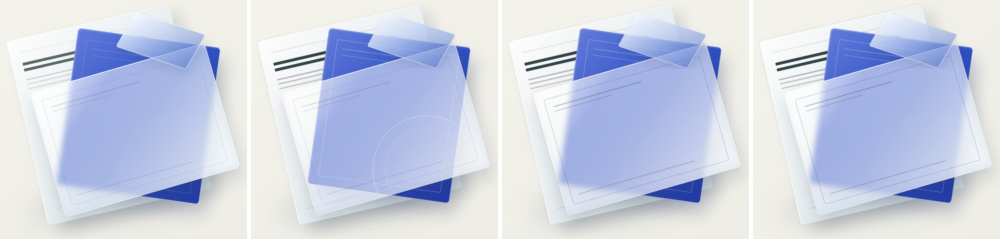

# Backdrop-Filter As A Layered Native Glass

`backdrop-filter` blurs whatever is painted behind an element. OOXML has no backdrop filter, and
no object can read another object's pixels or clip itself to another object's outline, so the one
thing that cannot be a native effect is the blurred backdrop itself. Everything else about a glass
element can be.

Before, the whole glass was rasterised in isolation: nothing behind it to blur, so the cards
showed through crisp, and the glass's own tint, border, shadow and text were pixels.

Now a glass element is decomposed into the fewest non-native parts:

| Layer | Representation |
|---|---|
| Blurred backdrop, cut to the glass's own rounded/rotated shape | one picture (`raster_role="backdrop-layer"`) |
| Glass tint, border, shadow, corner radius | native shape, editable |
| Text and children inside the glass | native shapes, editable |
| Content below the glass | untouched native shapes |

The backdrop picture is captured on its own: everything painted before the element stays,
everything after it is hidden, and the element's own paint and descendants are neutralised so
only the blurred backdrop remains. Its alpha is the element's border-box shape.

Left to right: Chrome, real PowerPoint on `main`, real PowerPoint with this PR, LibreOffice with
this PR. Real PowerPoint output is from the Microsoft Graph render tool (embedded fonts stripped,
so only shapes and effects are comparable, not text metrics).

| Source (Chrome) | PowerPoint, before | PowerPoint, after | LibreOffice, after |
|---|---|---|---|
|  |  |  |  |

## Evidence

`test_backdrop_filter_becomes_a_blurred_layer_under_a_native_glass` (real Chromium) asserts the
layer is opaque and carries the underlying colour with no glass tint, that the rounded corner is
transparent, that content painted above the glass is not baked in, that the glass is a native
shape with a corner radius above the layer, and that the content below stays native.

## What this does not do (and cannot)

The backdrop layer is a picture, so it does not re-blur if the content beneath it moves in
PowerPoint. Nothing in OOXML can link one object's rendering to another's, so that is a ceiling of
the format, not a gap. The glass, its tint and its text edit and move natively. Restoring a live
CSS `backdrop-filter` when the PPTX is converted back to HTML needs the blur intent carried as
metadata, which is the next change.
