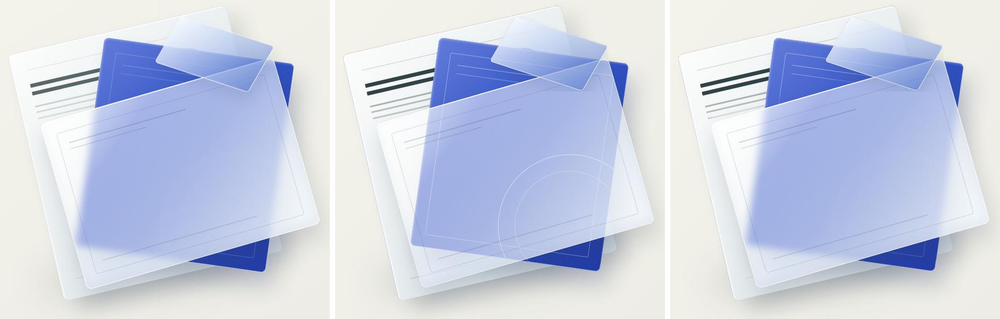

# Backdrop-Filter Composite Evidence

`backdrop-filter` blurs whatever is painted behind an element. Captured in isolation there is
nothing behind it, so the fallback layer was only the glass's own translucent tint: the cards
underneath showed through crisp, and the frosted look was lost.

A `backdrop-filter` element is now captured as a composite: the element together with everything
painted before it in document order (the stacking order the extractor models), with later content
hidden, cut to the element's own shape using its isolated alpha. Corners outside a rounded or
rotated glass stay transparent, and content painted above the glass is not baked in.

Left to right: Chrome source, `main` (flat tint, crisp edges through the glass), this PR.

| Source (Chrome) | Before (`main`, LibreOffice) | After (this PR, LibreOffice) |
|---|---|---|
|  |  |  |

## Evidence

`test_backdrop_filter_raster_carries_the_blurred_backdrop_in_its_own_shape` (real Chromium, fails
on `main`) asserts that the layer is opaque and carries the red box's colour where it sits over
that box, that the rounded corner is transparent, that a black shape painted above the glass is
not baked in, and that the red box stays a separate native shape.

## The limit, stated plainly

A baked composite is exact **in place** and cannot be exact **when something moves**: PowerPoint
has no backdrop blur, so a static layer cannot re-blur. If the glass is dragged it carries the old
blur with it; if a card beneath it is moved, the glass still shows the old blur. The shapes beneath
remain native and editable, but they are hidden under the opaque composite until it is moved or
deleted. The alternative (`main`'s tint-only layer) moves cleanly but does not look like the source
in place.

## Expected lossy behaviour (not part of this change)

Native PowerPoint text is still ~4px offset in LibreOffice. A glass whose shadow extends past its
box is cropped at the box, as before.
