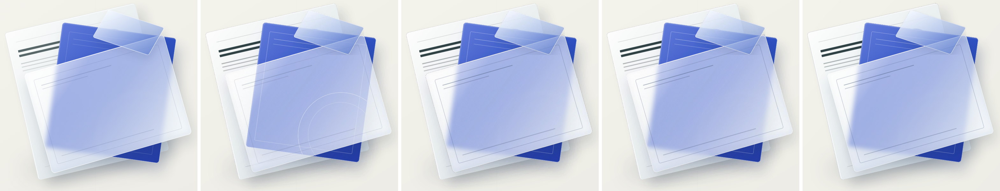

# Backdrop-Filter As A Live Native Blur

`backdrop-filter` blurs whatever is behind an element, and nothing in OOXML can read another
object's pixels. But PowerPoint **can** blur a picture itself, and it can clip that blur to the
picture's own outline. That is enough for a native design, found by probing real PowerPoint rather
than assuming:

| Probe (real PowerPoint) | Result |
|---|---|
| `a14:artisticBlur` (Artistic Effects) | not applied at render time; only the stored image shows |
| `a:blur` on a picture | applied live, radius editable |
| `a:blur grow="0"` | clips the blur to the picture's own outline, also when rotated and rounded |
| blur radius vs CSS sigma | best scale was **3x** at sigma 4, 8 and 16 px |

A glass element becomes:

| Layer | Representation |
|---|---|
| Sharp backdrop, sampled upright in the glass's own frame | picture-filled `roundRect`, rotated like the glass |
| Its blur | native `a:blur rad = 3 x sigma`, `grow="0"` (live, editable) |
| Glass tint, border, shadow, text | native, editable shapes above |
| What the browser blurred | the owned fallback picture, used only by renderers that ignore the effect |

The native shape sits in the `Choice` branch and is the one PowerPoint draws. (Other portable
fallbacks keep their native shape hidden and show the baked picture in PowerPoint too; a backdrop
blur is the opposite, since the live blur is the point.) Any backdrop filter that is not a plain
`blur(Npx)` (say `saturate()`), or a transform that cannot be undone as a rotation, keeps the single
baked layer.

Left to right: Chrome; real PowerPoint on the flat tint (before the glass work); real PowerPoint
with the baked layer (#63); **real PowerPoint with the native blur (this PR)**; LibreOffice, which
uses the owned fallback.

## Both directions

PPTX -> IR keeps the clipped blur, radius, rotation and the picture's role (a marker on the shape's
`cNvPr descr`, like pictures already had). IR -> HTML turns it back into a live
`backdrop-filter:blur(Npx)` on a transparent element and drops the picture, and re-rendering that
HTML reproduces the same native blur. `test_backdrop_blur_round_trips_through_pptx_and_html` proves
the whole cycle.

## Evidence

Mean absolute difference from Chrome in real PowerPoint (lower is better):

| Design | Whole glass | Blur zone |
|---|---:|---:|
| Flat tint (before) | 3.63 | 2.84 |
| Baked layer (#63) | 3.37 | 2.32 |
| **Native blur (this PR)** | **3.39** | **2.39** |

The native blur matches the browser-exact baked layer within noise while being live and editable.

## What it does not do

It still cannot re-blur when content beneath it moves: nothing in OOXML links one object to
another's pixels, so the sharp backdrop is a snapshot. What changes is that the blur radius is a
real setting, the glass and its blur move and edit as ordinary shapes, and HTML regains a true
`backdrop-filter`. The blur fades at the picture's outer edge slightly; at the calibrated radius it
is within noise of the browser.
