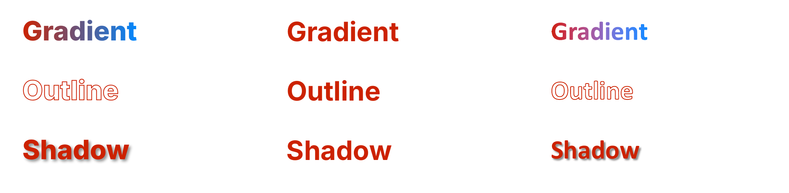

# Native Text Effects

CSS gradient text (`background-clip:text`), `-webkit-text-stroke` and `text-shadow` have native
run-level equivalents in PowerPoint, so none of them needs a raster. Before this change two of
them were not rasters but something worse: **silently dropped** (the ledger reported them "native"
because nothing was baked, while the effect itself was gone), and gradient text was drawn as an
opaque gradient *rectangle* over the glyphs.

The native forms were probed in real PowerPoint first (`scripts/native_lab.py text-fill`):

| CSS | DrawingML in `a:rPr` |
|---|---|
| `background-clip:text` + gradient | `a:gradFill` |
| `-webkit-text-stroke` | `a:ln` (with a transparent fill when `color:transparent`) |
| `text-shadow` | `a:effectLst/a:outerShdw` |

Left to right: Chrome, LibreOffice, **real PowerPoint**. LibreOffice cannot draw run-level
gradients, outlines or shadows and shows plain text; real PowerPoint matches Chrome on all three.

## What changed

- `TextRun` gains `gradient`, `outline` and `shadow`; the capture list gains the text-shadow and
  text-stroke styles.
- A `background-clip:text` element no longer paints its box (the background belongs to the glyphs),
  and the gradient's first stop is the run colour a renderer that ignores gradient text shows.
- The run writer emits `a:ln`, the fill and `a:effectLst` in schema order; the reader and the HTML
  writer round-trip them, so IR -> HTML is real CSS (`background-clip:text`, `-webkit-text-stroke`,
  `text-shadow`) and a second HTML cycle reproduces the same runs.
- The ledger now checks that a text effect is actually *present* in the IR (`expect_run`), which
  pixels cannot show while LibreOffice is the judge.

## Evidence

| Ledger case | Before | After |
|---|---|---|
| gradient text, similarity (LibreOffice) | 0.34, effect dropped | 0.88, effect in the IR |
| text-shadow / text-stroke, effect in the IR | dropped | present |

The ledger's similarity cannot reach 0.97 for these while LibreOffice is the judge; real
PowerPoint is, and it matches Chrome (above).

## Expected lossy behaviour (not part of this change)

A gradient on a block wider than its text spans the text, not the block (the CSS gradient would
stop at the text's own extent only if the element is shrink-wrapped). PowerPoint takes one shadow
per run, so extra `text-shadow` layers are not carried.
