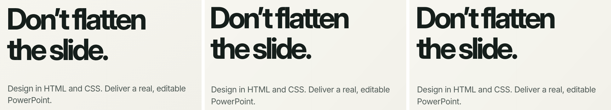

# Plain Text Slack Follows Alignment Evidence

A fill-less text box is widened so PowerPoint's slightly wider glyph metrics do not force a stray
wrap. The widening was applied 4px to the left and 4px to the right, with the text inset left at
0, so left-aligned text started 4px left of where the browser put it. Every plain text element on
the showcase slide was affected.

The slack now goes on the side the text is not anchored to: right for left-aligned text, left for
right-aligned, split for centred. The box keeps the same 8px of extra width, and the text stays
exactly where the browser placed it. Outside-bullet gutters are unchanged.

Left to right: Chrome source, `main`, this PR (LibreOffice renders, left text column).

## Evidence

Ink bounding box of each text element, left edge (px), from the full renders:

| Element | Source | Before (`main`) | After (this PR) |
|---|---:|---:|---:|
| Title | 83 | 79 | **83** |
| Subtitle | 87 | 83 | **87** |
| Tagline | 84 | 80 | **84** |
| Logo word | 126 | 122 | **126** |

`test_plain_text_slack_never_moves_the_text_it_is_anchored_to` (real Chromium, fails on `main`)
asserts the box edges for left, right and centred text: 200-508, 192-500 and 196-504 for a CSS box
at 200-500.

## Expected lossy behaviour (not part of this change)

A vertical offset of about 4px remains in LibreOffice and its sign differs by element (title up,
subtitle down), consistent with LibreOffice applying exact line spacing differently from
Chromium's half-leading. That is unverified against real PowerPoint (the local Graph render tool
returns HTTP 406 for every file), so it is deliberately not "corrected" here. The glass card is
still a flat image on `main`; see the backdrop-filter PR.
