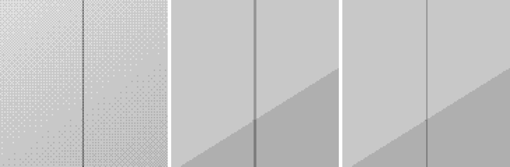

# Repeating Gradients As Native Many-Stop Gradients

A repeating gradient is the same colour ramp tiled along the gradient line. Over a box of known
size that is just an ordinary gradient with the ramp written out, so it never needed a raster.
The showcase slide's faint 400px grid lines (`repeating-linear-gradient`, hard stops) were being
baked into a picture.

This was **probed against real PowerPoint before it was built**: 40 hard-edged stops and a
121-stop ramp both render crisply and identically in real PowerPoint and LibreOffice, and alpha
stops work (so the same mechanism covers `mask-image` fades later).

Now `parse_repeating_gradient` expands one `repeating-linear-gradient` over the box: stop
positions in `px` or `%` (defaults resolved as CSS does), the period tiled across the gradient
line (its length depends on the angle), clipped to the box with exact interpolated boundary
colours, and hard edges kept hard (one OOXML position unit wide). It refuses what it cannot expand
exactly: other units, a zero period, extra layers, or more than 256 stops. The existing two-colour
`pattFill` mapping still wins where it applies, and a tiled `background-size` is never expanded.

Both directions come for free: an `a:gradFill` with many stops already converts back to a CSS
`linear-gradient`, and the test proves the stops (including the hard edges) survive a PPTX round
trip.

The DrawingML writer subdivides every gradient segment 8x so PowerPoint's interpolation tracks the
browser's. That is right for ramps but multiplied this pattern's 14 stops into 105. It now skips
segments that are flat runs or hard edges, where there is nothing to interpolate, and leaves every
smooth gradient exactly as before.

Left to right, amplified 25x: Chrome, real PowerPoint on `main` (baked picture), real PowerPoint
with this PR (native gradient).

## Evidence

| Real PowerPoint, stripe column (x=400) | Chrome | main (raster) | this PR (native) |
|---|---:|---:|---:|
| Dip below neighbouring pixels (grey levels) | 2.5 | 2.0 | 2.0 |

- Stripe width in real PowerPoint: Chrome 1px, `main` (baked picture) about 2px, this PR 1px, because
  the picture was resampled and the native gradient is not.
- Stops written for the slide's stripes: 105 (naive) -> 16.
- Raster layers for the stripes: 1 picture -> 0.
- `test_repeating_stripes_become_one_native_gradient_that_survives_both_ways` (real Chromium):
  native gradient, no picture, opacity kept, hard edges survive PPTX -> IR, and the HTML output is
  one CSS gradient.
- Five parser unit tests (hard edges, boundary colour, angle length, defaults, refusals).

## Expected lossy behaviour (not part of this change)

`_parse_stops` (ordinary `linear-gradient`) only understands `%` positions, so `px` stops are
silently spread evenly. That is an existing bug in a different path, noted for its own fix. The
stripe sits one pixel from Chrome's in the PDF only because the PDF page is 1601px wide.
