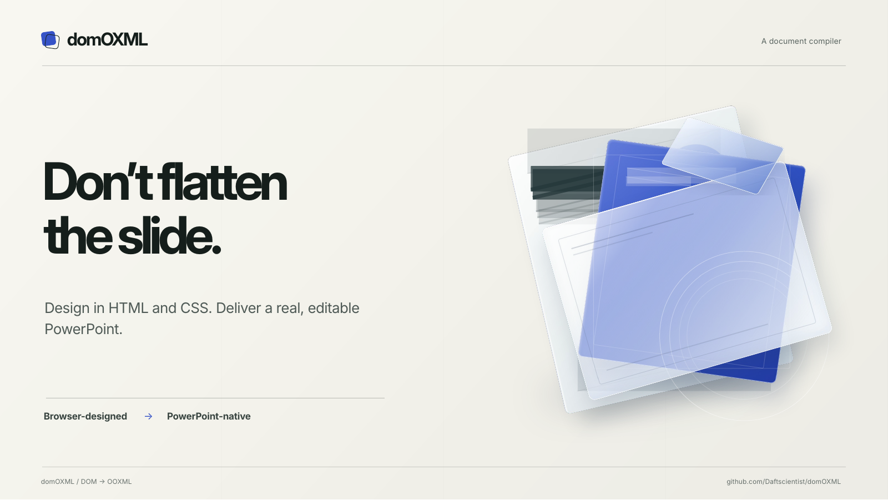
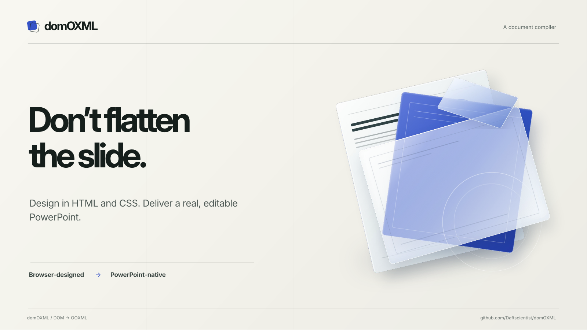

# Rotated Descendant Geometry Evidence

Fixture: the 1600x900 showcase slide, whose cards are `rotate()`d and contain hairlines, text bars
and a circle that have no transform of their own.

Every shape on a slide is positioned absolutely; nothing is nested. A descendant of a rotated
element therefore has to carry the rotation it is drawn with. The snapshot only recorded each
element's *own* computed `transform`, so a child with `transform: none` fell back to its bounding
box, the rectangle that encloses the rotated shape. A 357x1px hairline became a 348x81px solid
block and lost its tilt.

The snapshot now composes the linear part of every ancestor transform with the element's own, so a
descendant reports the rotation/flip it is actually drawn with and extraction recovers its true
layout size from `offsetWidth`/`offsetHeight`. Scale-only ancestors are left on their bounding box
(already exact), and SVG-namespace elements keep their own transform.

| Source (Chrome) | Before (`main`, LibreOffice) | After (this PR, LibreOffice) |
|---|---|---|
|  |  |  |

## Evidence: emitted shape boxes (CSS authored size in brackets)

| Element | Before | After |
|---|---:|---:|
| Card hairline (357x1) | 348 x 81, no rotation | 357 x 1, rotate(347deg) |
| Text bar (214x7) | 210 x 55, no rotation | 214 x 7, rotate(347deg) |
| Circle (106x106) | 127 x 127, no rotation | 106 x 106, rotate(347deg) |
| Blue-card hairline (198x1) | 196 x 29, no rotation | 198 x 1, rotate(8deg) |

Regression tests (real Chromium, all fail on `main`):
`test_descendants_of_a_rotated_element_keep_size_and_inherit_rotation`,
`test_nested_rotations_compose_and_cancelling_rotations_leave_no_transform`,
`test_text_inside_a_rotated_element_is_rotated_with_it`.

## Expected lossy behaviour (not part of this change)

The two decorative circles on the blue card still spill past the card edge: the card's
`overflow:hidden` is not applied to its native children. That is a separate clipping problem with
its own PR. The glass card is still a flat image (backdrop-filter) and the title text is still
offset about 4 px in LibreOffice; neither is changed here.
