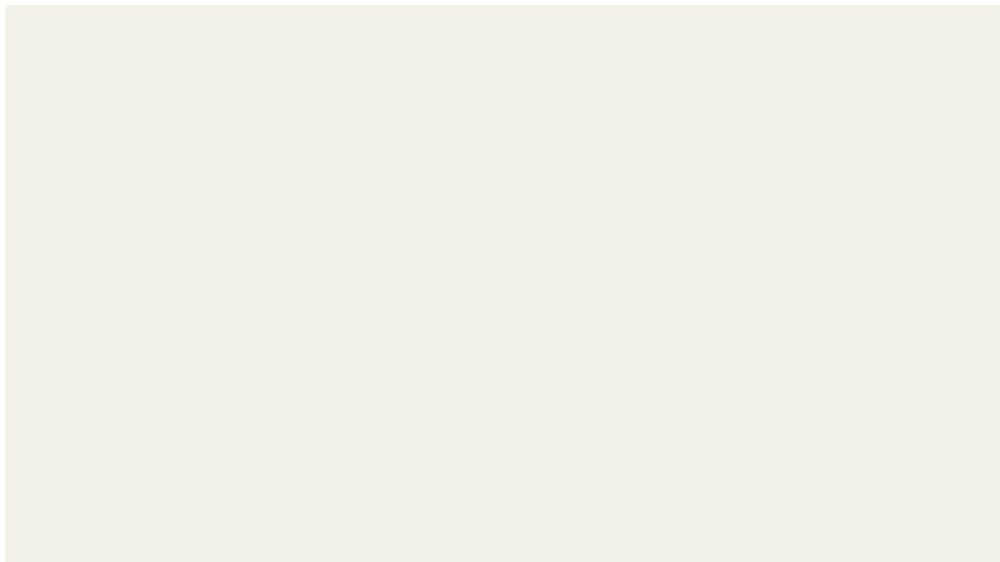
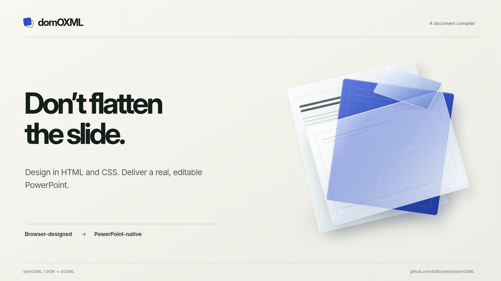

# Standalone Inline HTML Evidence

The HTML output used to be unusable on its own. `slides/slide-01.html` was a bare `
` fragment
whose layout (`position:absolute` on every shape, `position:relative` on the slide,
`white-space:pre-wrap` on text) lived in a separate `shared.css` that nothing linked. Opened
directly it rendered as a blank cream rectangle.

Two further problems came from the same shared stylesheet:

- A fragment has no `<meta charset>`, so a browser may decode `’` as mojibake.
- `@font-face` rules live in the same stylesheet and use `url(../assets/fonts/...)`, which is
  resolved relative to the stylesheet. From `html/shared.css` that points outside the output folder.

Now every layout rule is inline on the element that needs it, `HtmlPresentation.save` writes each
slide as a complete standalone page, and `shared.css` is gone. The only thing that cannot be an
inline style is `@font-face`; it is emitted in a `<style>` inside each page, so its relative URL
resolves from the page that uses it. `HtmlSlide.html` remains the fragment for programmatic use.

| Source (Chrome) | Before (`main`: saved slide opened directly) | After (this PR: saved slide opened directly) |
|---|---|---|
|  |  |  |

## Evidence

- Real-Chromium test `test_saved_slide_html_renders_on_its_own` saves a deck, opens
  `slides/slide-01.html` by `file://` with nothing else attached, and asserts the shape is
  `position:absolute` at exactly (100, 80, 300x120) and that U+2019 survives. It fails on `main`.
- `test_render_result_save_writes_every_artifact` asserts the page is a complete document with a
  declared charset, has no `<link>`, and that `shared.css` is not written.
- All 69 integration tests (including every HTML round trip) pass unchanged: inline layout is
  identical to what the class rules produced.

## Expected lossy behaviour (not part of this change)

The tilted-card geometry, doubled text and clip leaks visible in the "before" PPTX renders were
fixed in separate PRs. The glass card is still a flat image and native PowerPoint text is still
~4px offset in LibreOffice; neither is changed here.
