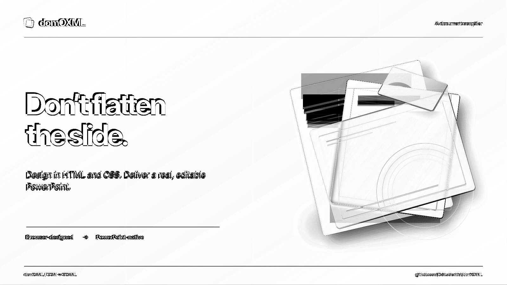

# Unified Raster Planning Evidence

Fixture: a 1600x900 showcase slide whose background uses a `repeating-linear-gradient` with no
native mapping, drawn under native text and several rotated cards.

Before this change the browser decided which elements get an isolated capture from its own CSS
predicate, while the extractor rasterised for reasons that predicate did not know about. When the
two disagreed, the extractor cropped the **fully composited** slide PNG as that element's pixels.
The gradient div is full-slide, so its "raster" contained every title, caption and card, and the
PPTX drew all of that text twice (once as the picture, once as native text).

Now the extractor is the single authority: a dry-run extraction records every raster it asks for,
the browser captures exactly those nodes in isolation, and a missing capture is a visible `FAILED`
coverage item instead of a silent crop of the composite.

| Source (Chrome) | Before (`main`, LibreOffice) | After (this PR, LibreOffice) |
|---|---|---|
|  |  |  |

| Diff before (x4 gain) | Diff after (x4 gain) |
|---|---|
|  |  |

## Evidence

| Check | Before | After |
|---|---:|---:|
| Text-coloured pixels inside the gradient layer's raster | 48,998 | 0 |
| Isolated-capture requests decided by | browser predicate | extractor |
| Planning pass cost on this slide | - | 5 ms |

The regression is `test_unmappable_background_raster_excludes_overlapping_native_text`
(real Chromium); it fails on `main` and passes here.

## Expected lossy behaviour (not part of this change)

Mean absolute difference against the Chrome source got slightly *worse* (text column 6.0 -> 8.7).
That is not a regression: the leaked copy was Chrome's own pixels, so it hid that LibreOffice
places the native title about 4 px up-left of Chrome's and about 1.3% narrower
(bbox `79,292-516,457` vs source `83,296-522,462`). The leaked copy made the slide look closer to
the source while being wrong. That native text offset is a separate problem and is tracked on its
own.

The tilted-card shapes that spill out of the cards and the flat (non-blurring) glass card are also
unchanged here; each is fixed in its own PR.
